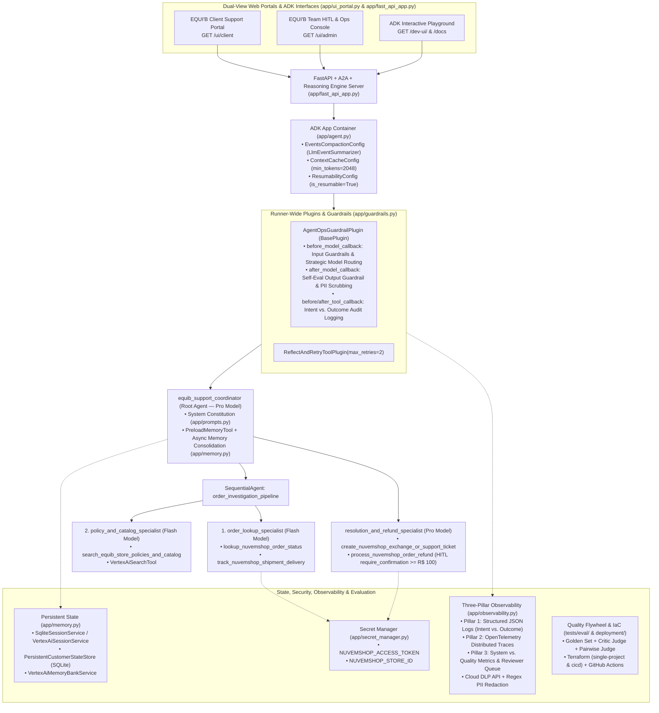

# Solution Architecture: EQUI'B Nuvemshop Customer Support & Order Status Agent (`equib-nuvemshop-support`)

- **Public GitHub Repository**: https://github.com/ericoyamamoto-google/equib-nuvemshop-support
- **README & 95/95 Rubric Matrix**: [README.md](README.md)
- **Agent Specification**: [.agents-cli-spec.md](.agents-cli-spec.md)

---

## 1. Executive Summary & Problem Statement

- **Business Problem**: Managing post-purchase customer support for **EQUI'B**'s e-commerce storefront on **Nuvemshop (Tiendanube)**—spanning order verification, multi-carrier tracking (`Correios`, `Jadlog`, `MelhorEnvio`), Brazilian Consumer Defense Code (`CDC Art. 49`) 7-day statutory regret refunds vs. 30-day complimentary size exchanges, and high-stakes financial refunds—is manual, latency-prone, and requires strict financial and privacy controls.
- **Agentic Solution**: An enterprise multi-agent system built with **Google Agent Development Kit (ADK) Python** and **`agents-cli`** that combines a Coordinator + Sequential Pipeline + Resolution Specialist architecture, strategic Flash/Pro model routing, strict Pydantic schemas, Cloud DLP PII redaction, OpenTelemetry GenAI semantic conventions, and Human-in-the-Loop (HITL) approval gates.

---

## 2. End-to-End Multi-Agent Architecture Diagram

---

## 3. Architectural Components by Rubric Category (95 / 95 Points)

### Category 1: Tool & Interface Design (20 Points)
- **Tools (`app/tools.py`)**:
  1. `lookup_nuvemshop_order_status`: Queries Nuvemshop order status, line items, payment state, and delivery window (`EQB-1001`, `EQB-1002`, `EQB-1003`).
  2. `track_nuvemshop_shipment_delivery`: Queries carrier tracking events (`Correios`, `Jadlog`, `MelhorEnvio`).
  3. `search_equib_store_policies_and_catalog`: Retrieves EQUI'B return/exchange policies (`CDC Art. 49` 7-day refund vs. 30-day size exchange) and product sizing guides.
  4. `create_nuvemshop_exchange_or_support_ticket`: Generates a support/exchange ticket with Correios reverse-logistics authorization.
  5. `process_nuvemshop_order_refund`: Executes financial refunds on Nuvemshop, gated by Human-in-the-Loop confirmation when `refund_amount_brl >= 100.00`.
- **Strict Pydantic Schemas (`app/schemas.py`)**: Every tool validates inputs and outputs via Pydantic `BaseModel` schemas with `ConfigDict(extra="forbid")`.
- **Guided Error Recovery**: Format mismatches (e.g., `#1001` instead of `EQB-1001`) return structured `"recovery_instruction"` hints so the LLM self-corrects without crashing.

### Category 2: Context & Memory (20 Points)
- **System Constitution (`app/prompts.py`)**: Defines persona, Brazilian CDC domain rules, and safety boundaries across `COORDINATOR_CONSTITUTION` and specialist instructions.
- **History Compaction (`app/memory.py`)**: Uses ADK `EventsCompactionConfig(token_threshold=32000, event_retention_size=5, summarizer=LlmEventSummarizer(...))`, `ContextCacheConfig`, and `compact_conversation_history()`.
- **Persistent Session State (`app/memory.py` & `app/app_utils/services.py`)**: Integrates `SqliteSessionService`, `VertexAiSessionService`, `PersistentCustomerStateStore`, `VertexAiMemoryBankService`, and `VertexAiSearchTool`.
- **Non-Blocking Async Memory Consolidation**: `async_memory_consolidation_callback` schedules background memory extraction via `asyncio.create_task()`.

### Category 3: Orchestration & Logic (20 Points)
- **Multi-Agent Hierarchy (`app/agent.py`)**: `equib_support_coordinator` delegates investigation to `order_investigation_pipeline` (`SequentialAgent` chaining `order_lookup_specialist` -> `policy_and_catalog_specialist`) and resolution to `resolution_and_refund_specialist`.
- **Strategic Model Routing (`app/guardrails.py`)**: `select_model_for_request()` routes low-latency lookup/policy queries to Flash (`gemini-3.8-flash`) and complex multi-step dispute/refund reasoning to Pro (`gemini-3.8-pro`).
- **Guardrails & Policy Plugins (`app/guardrails.py`)**: `AgentOpsGuardrailPlugin(BasePlugin)` enforces prompt-injection blocking, output self-evaluation (`evaluate_response_self_guardrail`), and tool policy caps.
- **Human-in-the-Loop (HITL) Hooks (`app/tools.py` & `app/ui_portal.py`)**: `FunctionTool(process_nuvemshop_order_refund, require_confirmation=requires_refund_human_approval)` and `tool_context.request_confirmation(...)` pause refunds `>= R$ 100.00` until approved or rejected by a supervisor in `/ui/admin`.

### Category 4: Observability & Tracing (20 Points)
- **Pillar 1 — Structured JSON Logging (`app/observability.py`)**: `StructuredJsonFormatter` emits structured JSON logs with `trace_id`, `span_id`, and `log_action_intent()` / `log_action_outcome()` pairs.
- **Pillar 2 — OpenTelemetry Distributed Tracing**: Configures `TracerProvider`, `EquibLocalSpanExporter`, `CloudTraceSpanExporter`, GenAI semantic conventions, and `should_sample_telemetry()` (100% error/HITL sampling).
- **Pillar 3 — System vs. Quality Metrics & Feedback Flywheel**: `compute_agent_metrics_summary()` tracks P50/P99 latency, token/cost estimates, trajectory adherence, safety guardrail pass rate, CSAT, and routes `👎` traces to the Reviewer Queue for promotion to the Golden Set (`promote_feedback_to_golden_dataset()`).
- **PII Redaction**: `PIIRedactor` scrubs emails, Brazilian CPFs, credit cards, phone numbers, and tokens via Google Cloud DLP API (`google.cloud.dlp_v2`) + regex fallback.

### Category 5: Infrastructure & CI/CD (15 Points)
- **Automated Evaluation Suites (`tests/eval/` & `tests/unit/test_agent_ops.py`)**: Golden dataset (`equib_eval_set.json`), LLM-as-a-Judge (`eval_config.json`), Critic Judge (`critic_agent_judge.py`), Pairwise Judge (`pairwise_judge.py`), Multi-Turn Simulation (`eval_config_multiturn.yaml`), and deterministic rubric unit tests (`test_agent_ops.py`).
- **Infrastructure as Code (`deployment/terraform/` & `.github/workflows/`)**: Terraform modules for `single-project` and `cicd` (including BigQuery telemetry sinks) and GitHub Actions workflows (`pr_checks.yaml`, `staging.yaml`, `deploy-to-prod.yaml`).
- **Secure Secret Management (`app/secret_manager.py`)**: Retrieves `NUVEMSHOP_ACCESS_TOKEN` and `NUVEMSHOP_STORE_ID` via `SecretManagerServiceClient` with zero hardcoded keys.

---

## 4. Web UI & API Testing Links

When the FastAPI server is running (`uv run uvicorn app.fast_api_app:app --host 0.0.0.0 --port 8000`):

| Interface / Endpoint | Localhost URL | Cloudtop Host URL | Purpose |
| :--- | :--- | :--- | :--- |
| **Client Support Portal** | http://localhost:8000/ui/client | http://ericoyamamoto.c.googlers.com:8000/ui/client | Test order lookups (`EQB-1001`, `EQB-1002`, `EQB-1003`), policy search, size exchange tickets, HITL refund requests, and `👍/👎` feedback. |
| **Team HITL & Ops Console** | http://localhost:8000/ui/admin | http://ericoyamamoto.c.googlers.com:8000/ui/admin | Approve/reject paused HITL refunds (`>= R$ 100.00`), inspect Pillar 3 metrics, promote `👎` traces to the Golden Set, and view PII-redacted JSON logs & OTel spans. |
| **ADK Dev UI Playground** | http://localhost:8000/dev-ui/ | http://ericoyamamoto.c.googlers.com:8000/dev-ui/ | Native Google ADK interactive chat and multi-agent graph inspector. |
| **Swagger / OpenAPI Docs** | http://localhost:8000/docs | http://ericoyamamoto.c.googlers.com:8000/docs | Interactive REST & A2A endpoint documentation. |
| **Live Telemetry Snapshot API** | http://localhost:8000/ui/api/telemetry | http://ericoyamamoto.c.googlers.com:8000/ui/api/telemetry | Raw JSON output of Pillar 1 Logs, Pillar 2 Traces, and Pillar 3 Metrics Scorecard. |
| **Live Portal State API** | http://localhost:8000/ui/api/state | http://ericoyamamoto.c.googlers.com:8000/ui/api/state | Raw JSON state for orders, HITL queue, tickets, Reviewer Queue, and feedback. |
