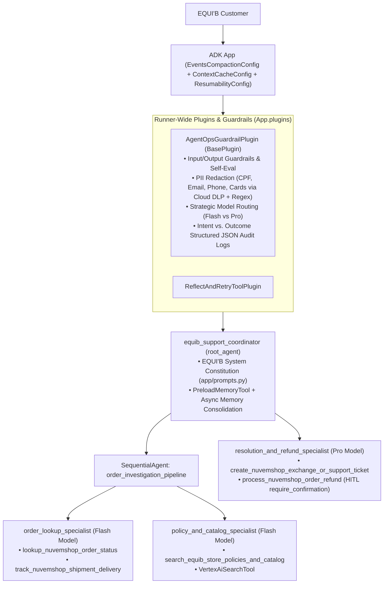

# EQUI'B Nuvemshop Customer Support & Order Status Agent (`equib-nuvemshop-support`)

An enterprise multi-agent system built with **Google Agent Development Kit (ADK) Python** and **`agents-cli`** for **EQUI'B**'s e-commerce storefront on **Nuvemshop (Tiendanube)**.

## Problem & Solution Statement

- **Problem**: Managing customer support inquiries for an online equestrian & lifestyle brand on **Nuvemshop**—including order status lookups, multi-carrier tracking (`Correios`, `Jadlog`, `MelhorEnvio`), Brazilian Consumer Code (`CDC Art. 49`) 7-day refund vs. 30-day size exchange eligibility, and high-stakes financial refunds—is manual, error-prone, and time-intensive.
- **Solution**: The **EQUI'B Nuvemshop Customer Support & Order Status Agent** (`equib_nuvemshop_support`) automates order verification, live shipment tracking, store policy grounding, exchange ticket generation, and Human-in-the-Loop (HITL) gated financial refunds with full OpenTelemetry tracing, PII redaction, and Terraform Infrastructure as Code.

---

## Architecture Overview



---

## AgentOps Code Review Matrix Mapping (95 / 95 Points)

| Category | Criterion | Points | Implementation Evidence in Repository |
| :--- | :--- | :---: | :--- |
| **1. Tool & Interface Design** | **Comprehensive Tool Docstrings** | 5 | `app/tools.py`: All 5 tool functions (`lookup_nuvemshop_order_status`, `track_nuvemshop_shipment_delivery`, `search_equib_store_policies_and_catalog`, `create_nuvemshop_exchange_or_support_ticket`, `process_nuvemshop_order_refund`) include complete Google-style docstrings (`Args:`, `Returns:`). |
| **1. Tool & Interface Design** | **Descriptive Naming** | 5 | `app/tools.py`: Highly specific verb-noun tool names (`lookup_nuvemshop_order_status`, `track_nuvemshop_shipment_delivery`, `create_nuvemshop_exchange_or_support_ticket`, `process_nuvemshop_order_refund`). |
| **1. Tool & Interface Design** | **Explicit JSON Schemas** | 5 | `app/schemas.py`: Strict Pydantic `BaseModel` schemas (`ConfigDict(extra="forbid")`, regex patterns, bounds) for inputs and outputs (`OrderLookupInput`, `OrderLookupOutput`, `ShipmentTrackingInput`, `ShipmentTrackingOutput`, `StorePolicySearchInput`, `SupportTicketInput`, `OrderRefundInput`). |
| **1. Tool & Interface Design** | **Guided Error Handling** | 5 | `app/tools.py`: Every tool catches `ValidationError` and domain errors and returns structured dicts with `"status": "error"`, `"error_code"`, and actionable `"recovery_instruction"` guidance for the LLM. |
| **2. Context & Memory** | **Robust System Instructions** | 5 | `app/prompts.py`: Defines `COORDINATOR_CONSTITUTION`, `ORDER_LOOKUP_INSTRUCTION`, `POLICY_SPECIALIST_INSTRUCTION`, and `RESOLUTION_SPECIALIST_INSTRUCTION` with persona, CDC domain rules, and non-negotiable safety constraints. |
| **2. Context & Memory** | **History Compaction** | 5 | `app/memory.py` & `app/agent.py`: Configures ADK `EventsCompactionConfig(token_threshold=32000, event_retention_size=5, summarizer=LlmEventSummarizer(...))`, `ContextCacheConfig(min_tokens=2048, ttl_seconds=1800, cache_intervals=10)`, and `compact_conversation_history()` token-budget sliding window truncation. |
| **2. Context & Memory** | **Persistent Session State** | 5 | `app/memory.py` & `app/app_utils/services.py`: Connects to `VertexAiSessionService`, `SqliteSessionService`, `PersistentCustomerStateStore` (SQLite DB), `VertexAiMemoryBankService`, and `VertexAiSearchTool`. |
| **2. Context & Memory** | **Async Memory Operations** | 5 | `app/memory.py`: `async_memory_consolidation_callback` schedules non-blocking background memory extraction via `asyncio.create_task(_consolidate_and_persist_memory_background(...))` alongside `PreloadMemoryTool()`. |
| **3. Orchestration & Logic** | **Multi-Agent Patterns** | 5 | `app/agent.py`: Coordinator `root_agent` orchestrates `order_investigation_pipeline` (`SequentialAgent` chaining `order_lookup_specialist` and `policy_and_catalog_specialist`) and `resolution_and_refund_specialist`. |
| **3. Orchestration & Logic** | **Strategic Model Routing** | 5 | `app/guardrails.py` & `app/agent.py`: Routes fast order/policy lookups to Flash (`gemini-3.8-flash`) and complex resolution/refund planning to Pro (`gemini-3.8-pro`) via `select_model_for_request()`. |
| **3. Orchestration & Logic** | **Guardrails & Policy Plugins** | 5 | `app/guardrails.py`: `AgentOpsGuardrailPlugin(BasePlugin)` and `ReflectAndRetryToolPlugin` registered on `App(plugins=...)` enforcing input prompt-injection blocking, output self-evaluation (`evaluate_response_self_guardrail`), and tool policy caps. |
| **3. Orchestration & Logic** | **Human-in-the-Loop Hooks** | 5 | `app/tools.py` & `app/agent.py`: High-stakes refunds (`>= R$ 100.00`) use `FunctionTool(process_nuvemshop_order_refund, require_confirmation=requires_refund_human_approval)`, `tool_context.request_confirmation(...)`, and `ResumabilityConfig(is_resumable=True)`. |
| **4. Observability & Tracing** | **Structured JSON Logging** | 5 | `app/observability.py`: `StructuredJsonFormatter` & `get_structured_logger()` emit structured JSON records with trace/span IDs and metadata (zero `print()` calls). |
| **4. Observability & Tracing** | **Intent vs. Outcome Capture** | 5 | `app/observability.py` & `app/guardrails.py`: `log_action_intent()` records `"event_type": "action_intent"` in `before_tool_callback` / `before_agent_callback`, and `log_action_outcome()` records `"event_type": "action_outcome"` in `after_tool_callback` / `after_agent_callback`. |
| **4. Observability & Tracing** | **Distributed Tracing** | 5 | `app/observability.py` & `app/fast_api_app.py`: OpenTelemetry `TracerProvider`, `EquibLocalSpanExporter`, `CloudTraceSpanExporter`, GenAI semantic conventions (`OTEL_SEMCONV_STABILITY_OPT_IN="gen_ai_latest_experimental"`, `OTEL_INSTRUMENTATION_GENAI_CAPTURE_MESSAGE_CONTENT="EVENT_ONLY"`), `trace_span()`, `should_sample_telemetry()` dynamic sampling, `compute_agent_metrics_summary()` Pillar 3 System vs. Quality Metrics, and `get_fast_api_app(otel_to_cloud=True)` link spans end-to-end. |
| **4. Observability & Tracing** | **PII Redaction** | 5 | `app/observability.py`: `PIIRedactor` scrubs emails, Brazilian CPFs, credit cards, SSNs, phone numbers, and tokens via Google Cloud DLP API (`google.cloud.dlp_v2`) + deterministic regex fallback before logging or memory writes. |
| **5. Infrastructure & CI/CD** | **Automated Evaluation Suites** | 5 | `tests/eval/equib_eval_set.json` (deterministic `tool_uses` trajectories + red-team & edge cases), `tests/eval/eval_config.json` (`rubric_based_final_response_quality_v1` LLM-as-a-Judge), `tests/eval/critic_agent_judge.py` (Agent-as-a-Judge Critic Agent), `tests/eval/pairwise_judge.py` (Pairwise A/B Evaluator), `tests/eval/eval_config_multiturn.yaml` (Multi-Turn Persona Simulation), `tests/eval/eval_config.yaml`, `tests/eval/datasets/basic-dataset.json` (`agents-cli eval run`), and `tests/unit/test_agent_ops.py` (`uv run pytest`). |
| **5. Infrastructure & CI/CD** | **Infrastructure as Code** | 5 | `deployment/terraform/` (`service.tf`, `iam.tf`, `telemetry.tf` with `feedback_logs_to_bq` BigQuery sink, `cicd/`) and `.github/workflows/` scaffolded and managed with `agents-cli`. |
| **5. Infrastructure & CI/CD** | **Secure Secret Management** | 5 | `app/secret_manager.py`: Fetches `NUVEMSHOP_ACCESS_TOKEN` and `NUVEMSHOP_STORE_ID` via `google.cloud.secretmanager.SecretManagerServiceClient` and runtime env injection; zero hardcoded secrets. |
| **Total** | **All 19 Criteria** | **95 / 95** | Verified by `uv run pytest tests/unit/test_agent_ops.py -v` |

---

## Quickstart & `agents-cli` Workflow

### 1. Install Dependencies (Including ADK Eval Extra)
```bash
uv sync --extra eval
```

### 2. Run Automated Rubric & Unit Tests
```bash
uv run pytest tests/unit/test_agent_ops.py -v
```

### 3. Smoke Test Locally with `agents-cli`
```bash
agents-cli run "Hi! Can you check the status and tracking for my EQUI'B order EQB-1001? My email is marina.silva@example.com."
```

### 4. Run Golden Dataset Evaluation Suites (ADK Eval & `agents-cli eval`)
```bash
# Option A: Native ADK Eval CLI (Deterministic tool_uses trajectories + rubric_based_final_response_quality_v1 LLM Judge)
uv run adk eval app tests/eval/equib_eval_set.json --config_file_path=tests/eval/eval_config.json --print_detailed_results

# Option B: agents-cli Quality Flywheel Evaluation Suite
agents-cli eval run
```

### 5. Launch Dual-View Web UI (`/ui/client` & `/ui/admin`)
Start the FastAPI server (`uv run uvicorn app.fast_api_app:app --host 0.0.0.0 --port 8000`) to access the two dedicated EQUI'B portals:
- **EQUI'B Client Support Portal (`http://localhost:8000/ui/client` or `http://<cloudtop-host>:8000/ui/client`)**: Customers can look up orders (`EQB-1001`, `EQB-1002`, `EQB-1003`), check carrier tracking, consult store policies, open 30-day size exchange tickets, and request refunds (with a live status banner when a refund `>= R$ 100.00` is paused awaiting HITL approval).
- **EQUI'B Team HITL & Operations Console (`http://localhost:8000/ui/admin` or `http://<cloudtop-host>:8000/ui/admin`)**: Internal support supervisors can review pending Human-in-the-Loop refund requests, click **Approve** or **Reject** to resume/complete the request, monitor Correios reverse-logistics exchange tickets, and inspect live PII-redacted structured JSON Intent vs. Outcome audit logs and OpenTelemetry distributed trace spans.

### 6. Provision Infrastructure (Terraform) & Deploy with GenAI Telemetry
```bash
# Provision single-project Terraform resources (Service Accounts, IAM, Telemetry, Secret Manager bindings)
agents-cli infra single-project --apply --project YOUR_GCP_PROJECT_ID

# Deploy to Vertex AI Agent Runtime with OpenTelemetry GenAI semantic conventions enabled
agents-cli deploy \
  --project YOUR_GCP_PROJECT_ID \
  --region us-central1 \
  --secrets "NUVEMSHOP_ACCESS_TOKEN=nuvemshop-token:latest" \
  --update-env-vars="GOOGLE_CLOUD_AGENT_ENGINE_ENABLE_TELEMETRY=true,OTEL_SEMCONV_STABILITY_OPT_IN=gen_ai_latest_experimental,OTEL_INSTRUMENTATION_GENAI_CAPTURE_MESSAGE_CONTENT=EVENT_ONLY"
```
